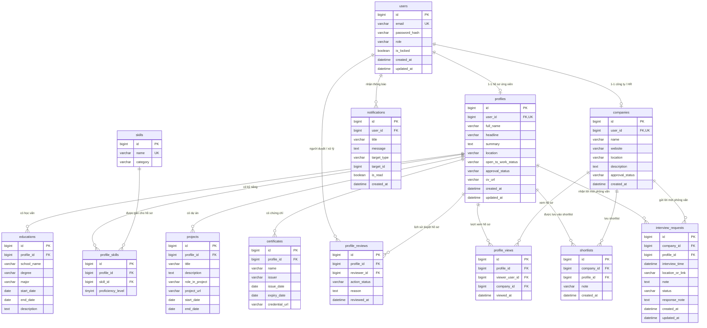

# TalentLink — Thiết kế Cơ sở dữ liệu (ERD, Foreign Keys & Indexes)

## 1. Sơ đồ ERD (Entity Relationship Diagram)

## 2.Giải thích các Khóa ngoại (Foreign Keys) chính

| Bảng con | Cột FK | Bảng tham chiếu | Ý nghĩa & ràng buộc toàn vẹn |
| :--- | :--- | :--- | :--- |
| `profiles` | `user_id` | `users(id)` | Liên kết 1-1 giữa tài khoản và hồ sơ ứng viên (`UNIQUE` trên `user_id`). |
| `companies` | `user_id` | `users(id)` | Liên kết tài khoản với hồ sơ công ty/HR (`UNIQUE` trên `user_id`). |
| `educations` | `profile_id` | `profiles(id)` | Lưu học vấn thuộc về hồ sơ ứng viên. |
| `profile_skills` | `profile_id` | `profiles(id)` | Liên kết hồ sơ ứng viên với bảng nối kỹ năng. |
| `profile_skills` | `skill_id` | `skills(id)` | Trỏ tới danh mục kỹ năng chuẩn; kết hợp `UNIQUE (profile_id, skill_id)`. |
| `projects` | `profile_id` | `profiles(id)` | Lưu các dự án gắn với hồ sơ ứng viên. |
| `certificates` | `profile_id` | `profiles(id)` | Lưu các chứng chỉ gắn với hồ sơ ứng viên. |
| `shortlists` | `company_id` | `companies(id)` | Xác định công ty lưu ứng viên vào danh sách quan tâm. |
| `shortlists` | `profile_id` | `profiles(id)` | Xác định ứng viên được lưu; kết hợp `UNIQUE (company_id, profile_id)`. |
| `interview_requests` | `company_id` | `companies(id)` | Xác định bên gửi yêu cầu phỏng vấn. |
| `interview_requests` | `profile_id` | `profiles(id)` | Xác định ứng viên nhận yêu cầu phỏng vấn. |
| `profile_reviews` | `profile_id` | `profiles(id)` | Ghi nhận lịch sử duyệt hồ sơ ứng viên. |
| `profile_reviews` | `reviewer_id` | `users(id)` | Ghi nhận người thực hiện duyệt hoặc từ chối. |
| `notifications` | `user_id` | `users(id)` | Xác định người dùng nhận thông báo. |
| `profile_views` | `profile_id` | `profiles(id)` | Ghi lại lịch sử hồ sơ được xem. |
| `profile_views` | `viewer_user_id` | `users(id)` | Ghi nhận người dùng xem hồ sơ (nếu có). |
| `profile_views` | `company_id` | `companies(id)` | Ghi nhận công ty xem hồ sơ để thống kê. |

## 3. Các Index chính & lý do đánh index

* **`users.email` (Unique Index):** Đảm bảo mỗi địa chỉ email chỉ đăng ký được một tài khoản duy nhất và tăng tốc độ tra cứu khi người dùng đăng nhập hoặc đặt lại mật khẩu.
* **`users(role, is_locked)` (Composite Index):** Tối ưu màn hình *Quản trị tài khoản* khi lọc nhanh danh sách người dùng theo vai trò và trạng thái khóa tài khoản.
* **`profiles(approval_status, open_to_work_status)` (Composite Index):** Tăng tốc độ truy vấn cho màn hình *Tìm ứng viên* (lọc hồ sơ đã duyệt và đang mở tìm việc) cũng như màn hình *Hàng chờ duyệt* (lọc các hồ sơ đang chờ duyệt).
* **`skills.name` (Unique Index):** Ngăn tạo trùng tên kỹ năng và hỗ trợ tìm kiếm/gán kỹ năng nhanh chóng.
* **`profile_skills(profile_id, skill_id)` (Unique Index):** Đảm bảo một hồ sơ ứng viên không bị gán trùng lặp cùng một kỹ năng nhiều lần.
* **`profile_skills(skill_id, proficiency_level)` (Composite Index):** Hỗ trợ lọc và sắp xếp ứng viên theo kỹ năng cụ thể kết hợp mức độ thành thạo (`1–5`).
* **`shortlists(company_id, profile_id)` (Unique Index):** Tránh lưu trùng một ứng viên vào danh sách quan tâm của cùng một công ty và kiểm tra nhanh trạng thái đã lưu.
* **`interview_requests(profile_id, status, interview_time)` (Composite Index):** Tối ưu danh sách *Yêu cầu phỏng vấn* phía ứng viên theo trạng thái phản hồi và thời gian phỏng vấn.
* **`interview_requests(company_id, status, interview_time)` (Composite Index):** Tối ưu danh sách *Yêu cầu phỏng vấn* phía nhà tuyển dụng/công ty theo trạng thái và lịch hẹn.
* **`profile_reviews(profile_id, reviewed_at)` (Composite Index):** Truy vấn nhanh lịch sử kiểm duyệt của từng hồ sơ theo thứ tự thời gian.
* **`notifications(user_id, is_read, created_at)` (Composite Index):** Tải nhanh thông báo của từng người dùng và đếm số lượng thông báo chưa đọc.
* **`profile_views(profile_id, viewed_at)` & `profile_views(company_id, viewed_at)` (Composite Index):** Hỗ trợ thống kê lượt xem hồ sơ ứng viên và hoạt động xem hồ sơ của công ty theo thời gian.
